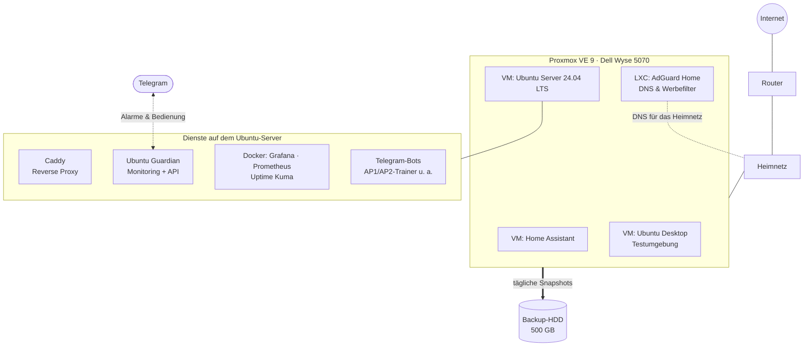

# Homelab

Mein privates Homelab auf Basis von **Proxmox VE**: ein stromsparender Thin Client als Virtualisierungs-Host, auf dem Hausautomation, DNS-Filterung und ein Ubuntu-Server mit eigenen Diensten laufen – überwacht, gesichert und größtenteils automatisiert.

Hier teste ich, was ich in der Umschulung und im Beruf lerne, unter realen Bedingungen: Virtualisierung, Linux-Administration, Netzwerk, Backup und Monitoring.

## Übersicht

## Komponenten

### Hardware

| Komponente | Ausstattung |
|---|---|
| Gerät | Dell Wyse 5070 Thin Client – lüfterlos, sehr geringer Stromverbrauch |
| CPU | Intel Celeron J4105, 4 Kerne |
| RAM | 16 GB |
| System & VMs | 256 GB SSD |
| Backups | 500 GB HDD, getrennt von den VM-Daten |

Der kleine Thin Client zeigt, dass ein sinnvolles Homelab keine teure Server-Hardware braucht – entscheidend ist, die Ressourcen bewusst zu verteilen.

### Proxmox-Host

| Bereich | Umsetzung |
|---|---|
| Virtualisierung | Proxmox VE 9.2 mit KVM-VMs und LXC-Containern |
| Speicher | LVM-Thin auf der SSD für VM-Disks, separate HDD für Backups |
| Sicherheit | Proxmox-Firewall aktiv |
| Wartung | eigener Timer für tägliche Paket-Updates, SMART-Überwachung der Festplatten (smartmontools) |
| Monitoring | eigener [Proxmox Monitor](proxmox-monitor/) überwacht Host, VMs, Speicher und Backups per Telegram |

### Virtuelle Maschinen und Container

| Typ | Name | Aufgabe |
|---|---|---|
| VM | Home Assistant | Hausautomation |
| VM | Ubuntu Server 24.04 LTS | Hauptserver für eigene Dienste (3 vCPU, 6 GB RAM) |
| VM | Ubuntu Desktop | Testumgebung, nur bei Bedarf gestartet |
| LXC | AdGuard Home | DNS-Server und Werbe-/Tracking-Filter für das ganze Heimnetz |

### Ubuntu-Server

| Dienst | Aufgabe |
|---|---|
| **Caddy** | Reverse Proxy mit internem TLS vor Grafana und Uptime Kuma – nur im Heimnetz erreichbar |
| **[Docker-Monitoring-Stack](https://github.com/eazzy1989/docker-monitoring-stack)** | Prometheus, Node Exporter, Grafana und Uptime Kuma per Docker Compose |
| **[Ubuntu Guardian](https://github.com/eazzy1989/ubuntu-guardian)** | eigenes Monitoring: Ressourcen, Dienste, Netzwerk, Zertifikate, Updates – Alarme und Bedienung per Telegram |
| **[FISI-Prüfungstrainer](https://github.com/eazzy1989/fisi-pruefungstrainer)** | Telegram-Bots zur Prüfungsvorbereitung, von meiner Lerngruppe genutzt |
| weitere Bots | private Automatisierungen (z. B. Benachrichtigungen) als systemd-Dienste |
| fail2ban | sperrt IPs nach wiederholten fehlgeschlagenen Anmeldungen |
| Canonical Livepatch | Kernel-Sicherheitsupdates ohne Neustart |
| chrony | Zeitsynchronisation |

Alle eigenen Anwendungen laufen als **systemd-Dienste** mit automatischem Neustart, Zugangsdaten liegen in `.env`-Dateien mit Rechten `600` – nie im Code.

## Sicherheit

| Ebene | Maßnahme |
|---|---|
| Proxmox-Host | Proxmox-Firewall aktiv, Verwaltung nur über benötigte Ports |
| Ubuntu-Server | Host-Firewall (ufw) mit Standard „alles verweigern“ – nur benötigte Dienste freigegeben, Verwaltungszugriff nur aus dem Heimnetz |
| SSH | Anmeldung ausschließlich per Schlüssel, Passwort- und root-Login deaktiviert |
| Angriffsschutz | fail2ban sperrt IPs nach wiederholten Fehlversuchen |
| Updates | automatische Sicherheitsupdates, Kernel-Livepatching ohne Neustart |
| Docker | Weboberflächen nur auf `127.0.0.1`, Zugriff über Caddy (internes TLS) bzw. SSH-Tunnel – keine an der Firewall vorbei veröffentlichten Ports |
| Notfallzugang | Proxmox-Konsole als Rückfallebene, falls SSH nicht verfügbar ist |

## Backup-Konzept

| | |
|---|---|
| Was | alle VMs und Container |
| Wie | Proxmox `vzdump` im Snapshot-Modus (ohne Ausfallzeit) |
| Wann | täglich um 00:30 Uhr |
| Wohin | separate Backup-HDD (500 GB) |
| Aufbewahrung | die letzten 3 täglichen, 2 wöchentliche und 2 monatliche Sicherungen |
| Zusätzlich | eigene Sicherung der Proxmox-Host-Konfiguration per Timer |

Damit lässt sich eine VM auf den Stand von gestern, letzter Woche oder letztem Monat zurücksetzen.

## Monitoring

- **Ubuntu Guardian** prüft alle paar Minuten CPU, RAM, Festplatten, Dienste, Netzwerk und Zertifikate und meldet Probleme per Telegram – inklusive Entwarnung, sobald ein Problem behoben ist.
- Der **[Proxmox Monitor](proxmox-monitor/)** überwacht den Host selbst: VMs und Container, Speicher, SMART, Backups und Netzwerk – ebenfalls per Telegram bedienbar.
- SMART-Werte der Festplatten werden laufend geprüft, um Ausfälle früh zu erkennen.
- **Prometheus + Grafana** speichern Metriken 30 Tage und zeigen Verläufe; vier Alarmregeln (Ziel nicht erreichbar, CPU, RAM, Festplatte).
- **Uptime Kuma** prüft Router, Proxmox, Home Assistant, Website und die Monitoring-Dienste selbst und meldet Ausfälle per Telegram.

## Was ich hier gelernt habe

- VMs und Container in Proxmox planen, betreiben und sichern
- Linux-Server härten und aktuell halten (Firewall, SSH nur per Schlüssel, fail2ban, Livepatch)
- eigene Dienste sauber als systemd-Units betreiben und Zugangsdaten vom Code trennen
- Monitoring und Alarmierung selbst bauen – und dabei Fehlalarme vermeiden
- ein Backup-Konzept mit Aufbewahrungsregeln umsetzen

## Verwandte Repos

- [ubuntu-guardian](https://github.com/eazzy1989/ubuntu-guardian) – Server-Monitoring per Telegram
- [fisi-pruefungstrainer](https://github.com/eazzy1989/fisi-pruefungstrainer) – Prüfungstrainer-Bots
- [exchange-migration-toolkit](https://github.com/eazzy1989/exchange-migration-toolkit) – PowerShell-Tools für Exchange-Migrationen
- [m365-graph-admin-scripts](https://github.com/eazzy1989/m365-graph-admin-scripts) – Microsoft-365-Administration mit Microsoft Graph
- [azure-bicep-lab](https://github.com/eazzy1989/azure-bicep-lab) – Azure-Infrastruktur als Code
- [docker-monitoring-stack](https://github.com/eazzy1989/docker-monitoring-stack) – Grafana, Prometheus und Uptime Kuma per Docker Compose
- [ubuntu-hardening-ansible](https://github.com/eazzy1989/ubuntu-hardening-ansible) – die Server-Härtung dieses Labs als Ansible-Playbook
- [ad-lab-powershell](https://github.com/eazzy1989/ad-lab-powershell) – Active-Directory-Lab mit PowerShell
- [network-lab-cisco](https://github.com/eazzy1989/network-lab-cisco) – Cisco-Netzwerk-Lab mit VLANs, OSPF, NAT und ACLs

## Lizenz

Dokumentation: [MIT](LICENSE)
